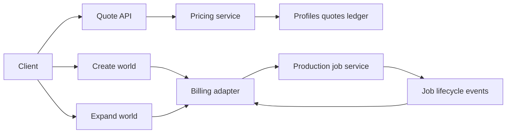

# Requirements

### Overview & Goals
Create a server-authoritative, auditable credit-pricing system for the **production app server**, which is not assumed to be the GUI API in this repository. A paid world has two independently billable operations: one call creates the initial world; each later call expands that same world by one or more frames. Operator-provided measurements and GPU rental prices must produce a stable quote that covers compute cost plus configurable profit.

**Core principle: we rent GPUs by TIME, so we price TIME.** Every credit charged is derived from *GPU wall-clock seconds the rented machine is occupied*, converted to money with the rental rate, inflated for idle/unsold time, then marked up. Frames are only an input used to *predict* seconds; they are never priced directly.

### Glossary (use these exact terms in code)
| Term | Meaning |
|---|---|
| `seed` / `initial_world` | First call: upload one image; server runs MoGe depth + intrinsics, builds the spatial cache. Fixed-time work, no video chunk. |
| `expand` / `expand_world` | Each later call: camera trajectory + optional prompt; server generates video chunks and updates the cache. |
| `chunk` | Lyra 2 generates in chunks of `chunk_frames = 80`. A partial chunk costs a full chunk. |
| `N_chunks` | `ceil(requested_frames / chunk_frames)`, minimum 1 for expand. |
| GPU-second | One second of wall-clock time that a rented GPU is reserved for a job (busy or not). |
| `utilization_bps` | Fraction (basis points, 10000 = 100%) of rented time we expect to be billed to customers. Covers idle time, cold starts, reverts we don't bill, etc. |
| `bps` | Basis points: 10000 = 100%, 5000 = 50%. All percentages are stored as integer bps. |
| `µUSD` | Micro-dollars (1 USD = 1,000,000 µUSD). All money is stored as integer µUSD. Never use floats. |
| `credit` | Integer unit the user spends. Its cash value is `micro_usd_per_credit` (default 10,000 = $0.01). |

`gui/api/server.py`, `gui/api/server_base.py`, and `gui/api/api_types.py` are useful references only: they show asynchronous request acceptance, duplicate request IDs, result polling, and `frame_count_without_padding`; they must not be treated as the production endpoint or workflow contract.

### Functional Requirements
- Quote and charge initial-world creation separately from world expansion. An expansion quote identifies the existing world/session and the exact requested incremental frames; it must not re-charge initial-world fixed work.
- Pin every accepted quote to the workload fingerprint, pricing-profile version, credit/cash conversion version, expiration, account, and idempotency key.
- Compute billable GPU seconds from operation-specific benchmark inputs, model-required padding/batching, and measured non-frame overhead. Display the estimate and exact credit charge before work starts.
- Debit atomically before a provider job is accepted. Reject insufficient funds, stale or altered quotes, duplicate client submissions, and expansions against an unauthorized/unknown world.
- Persist an append-only ledger for debits, holds, releases, and refunds. Define refunds for failure before GPU work starts, provider rejection, user cancellation before start, and post-start failure; never double-refund retries.

### Lyra 2 Facts the Agent Must Respect
- Expansion is chunked at 80 frames. Price per chunk, never per individual frame.
- Seed runs MoGe depth/intrinsics + spatial-cache init; treat it as fixed seconds.
- Each expansion runs, in order: Qwen3-VL prompt rewrite → T5 text encode → spatial-cache retrieval (`LYRA_GUI_RETRIEVAL_VIEWS`) → diffusion per chunk → VAE decode → cache update. Everything except diffusion is per-expansion fixed time; diffusion is per-chunk time.
- `LYRA_GUI_USE_DMD` changes diffusion time ~15× (≈540 s vs ≈35 s per 80-frame chunk on 1×H100). It, plus `LYRA_GUI_GUIDANCE`, `LYRA_GUI_RETRIEVAL_VIEWS`, `LYRA_GUI_OFFLOAD`, `LYRA_GUI_OFFLOAD_VAE`, resolution and checkpoint, MUST be part of the pricing-profile key. A quote for DMD-on can never be used for DMD-off work.
- **Revert** discards the latest chunk. The reverted work was already paid; a regenerate is a new, separately quoted `expand`. No refund for revert.
- Step-2 3D Gaussian Splatting reconstruction (`vipe_da3_chunked_gs_recon`) is **out of scope for v1** but the operation enum must include `reconstruct` so it can be priced later with the same formula.

### Exact Metrics Required
Collect measurements per **pricing profile** and per operation (`initial_world`, `expand_world`), not one generic “seconds per frame” value. Each observation must include:

- `provider`, `region`, `GPU type/count`, `rental billing rate`, rate currency, and billing granularity/minimum; separate GPU rental from any per-job/provider fee.
- `model/checkpoint version`, runtime/container version, precision, inference settings, resolution, frame rate where relevant, batch size, required batch multiple/padding rule, and concurrent-job configuration.
- Requested frames, **billable frames after padding**, produced frames, and whether it is initial creation or expansion.
- GPU wall-clock timestamps for queue/start/end; derive queue time separately and charge only the selected execution window, not customer queue delay.
- Initial-world fixed GPU seconds: model/session initialization, seed/context encoding, first-frame/world construction, warm-up (if charged), and teardown.
- Expansion fixed GPU seconds: world/session restore, prior-context loading, state synchronization, warm-up (if applicable), and teardown.
- Incremental GPU seconds by billable frame count, ideally several samples at each supported frame/batch size. Store median or a conservative percentile plus a configurable variance buffer rather than a single run.
- Actual provider-billed duration/cost for reconciliation, success/failure status, and timestamp. This validates the estimate and supports later profile updates without rewriting past quotes.
- **Per-stage timers** the production server must log for every job (seconds, float, measured with `torch.cuda.synchronize()` before reading the clock): `model_load_s` (cold start only), `moge_s`, `cache_init_s`, `vlm_rewrite_s`, `t5_encode_s`, `retrieval_s`, `diffusion_s_per_chunk[]`, `vae_decode_s`, `cache_update_s`, `total_gpu_wall_s`, `peak_vram_gb`.
- **Time-rental facts** for each GPU contract: `billing_granularity_s` (1, 60 or 3600), `minimum_billed_s`, whether the instance is always-on (reserved) or spun up per job (on-demand), and `cold_start_s` (boot + model load) for on-demand.
- **Fleet utilization**: monthly `sum(billed customer GPU-seconds) / sum(rented GPU-seconds)`. This number drives `utilization_bps`.

### Benchmark Input File (operator provides this)
One JSON file per benchmark batch, loaded by `scripts/billing/import_benchmarks.py` which aggregates runs into a new profile version (never edits an old one):
```json
{
  "profile_key": {"gpu": "H100-80GB", "gpu_count": 1, "provider": "runpod", "checkpoint": "lyra2-v1",
                   "use_dmd": true, "guidance": 5.0, "retrieval_views": 1, "offload": true,
                   "offload_vae": false, "resolution": "832x480"},
  "rental": {"rate_micro_usd_per_hour": 2500000, "billing_granularity_s": 1,
             "minimum_billed_s": 0, "mode": "reserved", "cold_start_s": 0},
  "runs": [
    {"operation": "initial_world", "moge_s": 12.1, "cache_init_s": 6.0, "total_gpu_wall_s": 19.4},
    {"operation": "expand_world", "chunks": 1, "vlm_rewrite_s": 4.2, "t5_encode_s": 0.8,
     "retrieval_s": 2.1, "diffusion_s_per_chunk": [34.7], "vae_decode_s": 5.0,
     "cache_update_s": 2.4, "total_gpu_wall_s": 49.8}
  ]
}
```
Aggregation rule: `fixed_s[op]` = **p90** of (total minus diffusion) across runs; `per_chunk_s` = **p90** of all `diffusion_s_per_chunk` values. Require ≥10 runs per operation, else the importer refuses. Store raw runs too.

### Defaults (configurable, versioned)
| Setting | Default |
|---|---|
| `gross_margin_bps` | 5000 (50%) |
| `variance_buffer_bps` | 2000 (+20%) |
| `utilization_bps` | 6000 (60% of rented time is sold) |
| `micro_usd_per_credit` | 10000 ($0.01 per credit) |
| `min_credits_per_job` | 1 |
| `quote_ttl_s` | 300 |
| `hold_auto_release_s` | 1800 (no start event → release) |
| `session_idle_timeout_s` | 600 (GPU session evicted after idle) |

### Scope
- In scope: versioned manual benchmark/rate ingestion, separate operation quotes, integer-credit ledger/accounting, authenticated job authorization, customer estimate/confirmation, and reconciliation data.
- Out of scope: payment-provider checkout, automatic cloud-price scraping, or changes to model inference itself.

# Technical Design

### Integration Boundary
Implement billing as a production-server adapter around the two real job commands—`CreateWorld` and `ExpandWorld`—rather than inside model code. The adapter needs only a normalized workload descriptor and two lifecycle callbacks: `accepted_by_provider` and `started_on_gpu`/terminal status. This permits adoption even though the full production code is unavailable.



The local GUI reference has `POST /request-inference` calling `InferenceModel.request_inference()` after validation in `server_base.py`; in production, place the equivalent atomic debit-and-submit guard at the application/API boundary immediately before its initial-world or expansion job is enqueued. Preserve the underlying job service as execution-only.

### Pricing Profile and Formula (time-based)
All integers. `ceil_div(a, b) = (a + b - 1) // b`. Implement exactly this in `pricing.py` as a pure function with no I/O:

```text
# 1. Predict seconds the GPU is occupied
N_chunks   = 0 if op == initial_world else max(1, ceil_div(requested_frames, chunk_frames))
T          = fixed_s[op] + N_chunks * per_chunk_s            # p90 values from profile, int seconds (ceil)
T          = T + cold_start_s     (only if rental.mode == on_demand)
T_buf      = ceil_div(T * (10000 + variance_buffer_bps), 10000)
T_bill     = max(minimum_billed_s, ceil_div(T_buf, billing_granularity_s) * billing_granularity_s)

# 2. Pay for idle rented time too (we rent by the hour, not by the job)
T_paid     = ceil_div(T_bill * 10000, utilization_bps)

# 3. Time -> money -> price -> credits
C_compute  = ceil_div(rate_micro_usd_per_hour * T_paid, 3600) + per_job_fee_micro_usd
C_sell     = ceil_div(C_compute * 10000, 10000 - gross_margin_bps)
credits    = max(min_credits_per_job, ceil_div(C_sell, micro_usd_per_credit))
```

Why `utilization_bps`: a reserved GPU costs the same per hour whether busy or idle (between a user's clicks, cold starts, unbilled reverts, nights). Dividing by expected utilization spreads that idle cost across sold seconds. Reconciliation (Step 4) recomputes the real utilization monthly and publishes a new config version if it drifts.

`50%` margin means `C_sell = 2 × C_compute` (profit is half of revenue), NOT `1.5 ×`.

### Worked Examples (use as unit-test fixtures)
Profile: 1×H100 at $2.50/hr → `rate = 2,500,000 µUSD/h`, granularity 1 s, reserved, buffer 2000, util 6000, margin 5000, 10,000 µUSD/credit.

| Case | T | T_buf | T_paid | C_compute µUSD | C_sell µUSD | credits | cash |
|---|---|---|---|---|---|---|---|
| Seed (`fixed_s=20`) | 20 | 24 | 40 | 27,778 | 55,556 | 6 | $0.06 |
| Expand DMD on, 80 frames (`fixed_s=15`, `per_chunk_s=35`) | 50 | 60 | 100 | 69,445 | 138,890 | 14 | $0.14 |
| Expand DMD off, 80 frames (`fixed_s=15`, `per_chunk_s=540`) | 555 | 666 | 1110 | 770,834 | 1,541,668 | 155 | $1.55 |
| Expand DMD on, 100 frames → 2 chunks | 85 | 102 | 170 | 118,056 | 236,112 | 24 | $0.24 |

Seconds figures are placeholders until the operator's benchmarks are imported; the arithmetic must match exactly.

### Key Decisions
- **Hold → capture**, not immediate debit: submit creates a `hold`; `started_on_gpu` converts it to `capture`; pre-start failure creates `release`. Balance shown to user = `sum(ledger) - open holds`.
- **Price is fixed at quote time.** If actual time runs over, we eat it; reconciliation corrects future profiles.
- **Default stack if production stack is unknown:** Python 3.10 + FastAPI, PostgreSQL, SQLAlchemy 2 + Alembic, JWT bearer auth (user id from `sub`). If the production server differs, keep the same table/endpoint contracts.
- **Concurrency:** balance changes use `SELECT ... FROM credit_accounts WHERE id=:id FOR UPDATE` inside the transaction; `credit_ledger.idempotency_key` has a UNIQUE constraint; a duplicate key returns the original result (HTTP 200), never a second hold.

### Contracts and State
- `PricingProfile`: append-only profile/version, compatibility fields, operation-specific fixed seconds and per-frame seconds, rate and provider fees, buffer, margin, and effective interval.
- `GenerationQuote`: account, operation, world ID for expansions, normalized workload fingerprint, `N_chunks`, formula inputs/results, profile/conversion versions, expiry, and state (`issued`, `consumed`, `expired`).
- `CreditLedgerEntry`: immutable account delta with type (`grant`, `hold`, `capture`, `release`, `refund`), quote/job reference, idempotency key, and timestamps.
- Normalize the production commands into `CreateWorldWorkload` and `ExpandWorldWorkload`; each must contain only cost-driving fields. Hash the normalized descriptor so accepted work cannot differ from quoted work.

### Tables (minimum columns)
- `pricing_profiles(id, version, profile_key_json, profile_key_hash, fixed_s_seed, fixed_s_expand, per_chunk_s, chunk_frames, rate_micro_usd_per_hour, billing_granularity_s, minimum_billed_s, mode, cold_start_s, per_job_fee_micro_usd, effective_from, effective_to NULL)`
- `pricing_config(id, version, gross_margin_bps, variance_buffer_bps, utilization_bps, micro_usd_per_credit, min_credits_per_job, quote_ttl_s, effective_from)`
- `benchmark_runs(id, profile_id, operation, raw_json, created_at)`
- `credit_accounts(id, user_id UNIQUE, created_at)` — balance is derived from ledger, never stored mutable.
- `credit_ledger(id, account_id, type ENUM(grant,hold,capture,release,refund), credits INT signed, quote_id NULL, job_id NULL, idempotency_key UNIQUE, created_at)`
- `generation_quotes(id UUID, account_id, operation, world_id NULL, workload_hash, requested_frames, n_chunks, t_paid_s, c_compute, c_sell, credits, profile_id, config_id, state ENUM(issued,consumed,expired), expires_at)`
- `generation_jobs(id, quote_id UNIQUE, world_id, state ENUM(held,started,succeeded,failed,cancelled), timestamps queued/started/ended, actual_gpu_wall_s, stage_timings_json)`

### API Contracts
`POST /v1/quotes` → `{"operation":"expand_world","world_id":"w_123","requested_frames":80,"settings":{"use_dmd":true,...}}` returns `{"quote_id","operation","requested_frames","billable_frames":80,"n_chunks":1,"estimated_seconds":60,"credits":14,"cash_value_usd":"0.14","margin_bps":5000,"profile_version","expires_at"}`. (`estimated_seconds` shows `T_buf`, not `T_paid`.)
`POST /v1/worlds` (seed) and `POST /v1/worlds/{world_id}/expand` require headers `Quote-Id` and `Idempotency-Key`; return `202 {"job_id","credits_held"}`.
`GET /v1/credits/balance` → `{"available","held"}`; `GET /v1/credits/ledger?cursor=`.
Error codes (HTTP 4xx, body `{"error":code}`): `insufficient_credits` 402, `quote_expired` 409, `quote_consumed` 409, `quote_mismatch` 409 (hash differs), `unknown_world` 404, `world_forbidden` 403, `no_profile` 422 (no profile for these settings).

### Refund / Ledger Rules
| Event | Ledger action |
|---|---|
| Submit accepted | `hold -credits` |
| Enqueue/provider rejects before start | `release +credits` |
| User cancels before start | `release +credits` |
| No start within `hold_auto_release_s` | `release +credits` + alert |
| GPU work starts | `capture` (0 delta, converts hold) |
| Success | none |
| Server-side failure after start (OOM, crash) | `refund +credits` (our fault) |
| User cancels after start | none (charge kept) |
| User clicks Revert | none; regeneration is a new quote |

### Customer Flow and Failure Semantics
1. Client requests a quote for create or expand; response displays operation, requested and billable frames, estimated GPU time, compute cost, margin, final credits, cash-per-credit ratio, and expiry.
2. Client accepts and submits the quote with an idempotency key. One transaction validates ownership/expiry/fingerprint/world authorization, writes the ledger hold, consumes the quote, and persists the job authorization.
3. The job service submits work. If submission fails before provider acceptance, write one idempotent release/refund. Once GPU work starts, retain the agreed quoted charge unless an explicit goodwill/refund policy applies.
4. Store terminal actuals for reconciliation; profile changes affect only future quotes.

### Risks
- **Idle pinned GPUs:** if a session holds a GPU between expansions, that idle time is real cost. Evict sessions after `session_idle_timeout_s` (persist the spatial cache to disk) and keep `utilization_bps` honest via reconciliation.
- **Hourly-granularity rentals:** with `billing_granularity_s=3600` per-job, `T_bill` rounds to an hour; use that only for on-demand per-job instances. For reserved machines set granularity 1 and rely on `utilization_bps`.
- Initial creation may be nonlinear while expansion time can depend on accumulated world context. Profile selection must include any context-size tier that materially changes timing; add tiers after measurements demonstrate the dependency.
- Queuing, uploads, downloads, and CPU postprocessing can distort wall time. Record them separately and include them in price only through an intentional fixed fee/overhead policy.
- The GUI server’s synchronous path (`request_inference_sync`) is not evidence that the production system should have synchronous billing; the quote/debit contract must remain valid for asynchronous job execution.

# Testing

### Validation Approach
- Unit-test the formula with operation-specific fixed time, padding, buffers, hourly rate, fees, `50%` margin, minimums if enabled, and upward rounding.
- Test profile compatibility/version pinning and workload hashes for both create and expand commands, including context-tier selection where enabled.
- Integration-test quote → atomic debit/hold → job acceptance, quote expiry, altered payload, duplicate retries, insufficient balance, unknown/unauthorized world, provider rejection, and terminal refund transitions.
- Reconcile fixture actual billed durations/costs against quote records and ensure only future profiles change after new measurements are loaded.
- `pricing.py` tests must reproduce every row of the Worked Examples table exactly.
- Concurrency test: two simultaneous submits with the same `Idempotency-Key` create one hold; two different submits that together exceed balance → exactly one succeeds.
- Importer tests: <10 runs rejected; p90 aggregation correct; importing creates a new version and leaves old quotes untouched.

# Delivery Steps

### Step 0: Add per-stage GPU timers to the production server
Every seed/expand job logs the stage timings and total GPU wall time listed in Exact Metrics.
- Wrap MoGe, cache init, VLM rewrite, T5, retrieval, each diffusion chunk, VAE decode, cache update with synchronized timers.
- Emit one JSON record per job including all profile-key settings; this same format feeds the benchmark importer.

### Step 1: Define operation-specific measurements and pricing profiles
The system has a precise, versioned data contract for initial-world and expansion cost inputs.
- Define `initial_world` and `expand_world` benchmark/profile fields, including fixed GPU seconds, billable-frame timing, padding rules, provider rate/granularity, fees, workload qualifiers, and variance buffer.
- Add append-only storage for profiles, benchmark observations, conversion-rate versions, credit accounts, and immutable ledger entries.
- Capture actual provider duration/cost and job lifecycle timestamps separately from estimation inputs.
- Validate profile selection and metric completeness with fixtures for both operation types.

### Step 2: Implement deterministic quotes and credits-to-cash conversion
Each create or expand request receives an explainable, stable credit quote.
- Normalize production create/expand payloads into cost-driving workload descriptors and hash them.
- Implement the documented formula for buffered GPU seconds, compute cost, gross-margin sale cost, and ceiling conversion to credits using integer arithmetic.
- Issue short-lived quotes that pin operation, world ID when expanding, profile and conversion versions, all formula inputs, and final display values.
- Test padding, fixed overhead, rate granularity, `50%` margin, rounding, and profile history.

### Step 3: Add transactional billing around production job submission
Only authorized, funded quotes can create or expand a world.
- Add authenticated quote, balance, and ledger endpoints/contracts to the production app server, not by assuming `gui/api/server.py` is its implementation.
- At the real create/expand enqueue boundary, transactionally validate quote ownership/fingerprint/world authorization, consume the quote, create an idempotent debit/hold ledger entry, and persist job authorization.
- Connect provider acceptance/start/terminal callbacks to idempotent release/refund behavior defined for each pre-start and post-start outcome.
- Test retry safety, insufficient credit, stale/altered quote, unauthorized expansion, rejection, and refund cases.

### Step 4: Show transparent costs and reconcile operating data
Customers understand the charge before execution, and operators can verify margins against reality.
- Present operation type, requested/billable frames, time estimate, credit charge, cash-per-credit ratio, quote expiry, and confirmation control in the actual client flow.
- Preserve the selected quote ID through create and expansion submissions and surface actionable balance/expiry errors.
- Build reconciliation reporting from actual provider-billed cost versus quoted compute cost, grouped by profile/version and operation.
- Use reconciliation results to publish new profile versions without changing historical charges.
- Monthly job: real `utilization_bps = billed customer GPU-seconds / rented GPU-seconds from provider invoice`; report realized margin per profile; flag if realized margin < 40%.